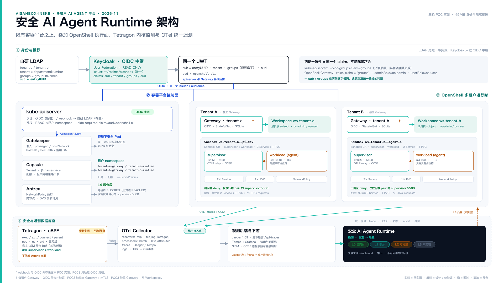

# 多租户安全 AI Agent Runtime

> 在既有容器平台之上，叠加 OpenShell 执行面、Tetragon 内核监测与 OTel 统一遥测。
> 本文是三轮 POC 的**汇总与落地设计**，配套演示文稿：[`aisanbox-security-ai-runtime-poc.pptx`](aisanbox-security-ai-runtime-poc.pptx)。

| 项 | 值 |
|---|---|
| 版本 | 2026-11-10 |
| 范围 | 既有容器平台（apiserver + LDAP + Antrea + Capsule + Gatekeeper）之上新增 AI Agent 运行时 |
| 证据 | 3 轮 POC · 11 项能力 · 14 条安全用例 · POC3 49 条身份/隔离用例 |
| 结论 | 主干跑通；**两个同步器 + 一个可留存后端**是生产化前提 |
| 原始结论 | [`../README.md`](../README.md)（唯一出处）· [`../poc/docs/POC2-CONCLUSIONS.md`](../poc/docs/POC2-CONCLUSIONS.md)（逐条输出） |

**阅读约定**：`✅ 实测通过` / `⚠️ 部分或有条件` / `❌ 未验证` / `📐 设计（未实测）`。
本文不把设计预期写成实测结果；每个 ✅ 都能在 [`../README.md`](../README.md) 第 7、12.7 节找到可粘贴的复验命令。

---

## 目录

1. [一页结论](#1-一页结论)
2. [背景：既有平台解决了什么，没解决什么](#2-背景既有平台解决了什么没解决什么)
3. [目标架构](#3-目标架构)
4. [身份与授权：LDAP → Keycloak → 一条 JWT](#4-身份与授权ldap--keycloak--一条-jwt)
5. [多租户运行时：1 租户 = 1 Gateway = 2 ns](#5-多租户运行时1-租户--1-gateway--2-ns)
6. [四层隔离与沙箱边界](#6-四层隔离与沙箱边界)
7. [Tetragon：给 Supervisor 补上内核侧真相](#7-tetragon给-supervisor-补上内核侧真相)
8. [OTel 与安全 AI Agent 的数据底座](#8-otel-与安全-ai-agent-的数据底座)
9. [验证结果](#9-验证结果)
10. [方法论：五个“差点写错”的结论](#10-方法论五个差点写错的结论)
11. [复现](#11-复现)
12. [生产化差距与路线图](#12-生产化差距与路线图)
13. [附录](#13-附录)

---

## 1. 一页结论

这套组合要解决的不是“再装一个 Kubernetes 组件”，而是把 **AI Agent 的执行**纳入平台已有的身份、隔离与审计体系：

```
既有：apiserver 认证 webhook → 自研 LDAP
      Antrea（NetworkPolicy 执行）· Capsule（多 ns / 配额）· Gatekeeper（准入）

新增：OpenShell Runtime（每租户 Gateway / Workspace / Sandbox）
      ↑ 身份仍来自 LDAP，Keycloak 只做 OIDC 中继
      ↑ Tetragon 提供内核侧行为真相
      ↑ OTel 把 Agent / Gateway / Supervisor / OCSF / Tetragon 汇入同一观测面
```

**四条已经站得住的结论**

| # | 结论 | 证据 |
|---|---|---|
| 1 | **一条身份链可以同时管住 K8s 与 OpenShell**：LDAP 是唯一事实源，Keycloak 联邦后签发同一个 JWT，apiserver 与 Gateway 读同一个 `sub` 与 `groups` | POC3 `PASS=49 FAIL=0`；`sub == entryUUID`；两侧 `roles_claim = groups` |
| 2 | **隔离是四层，不是一层**：准入（Gatekeeper）、租户（Capsule）、网络（Antrea）、执行（OpenShell）各拦一段，拒绝必须能归因到层 | POC-02/05/06、SEC-01..14、N-01..05 |
| 3 | **Agent 绕不过 Supervisor 的边界**：workload 出网全 deny，只放行同一 boundary-pair 的 `supervisor:5500`；换进程、开原始 socket 也一样 | SEC-13 正对照 `CONNECTED`，其余 `TIMEOUT`/`EAI_AGAIN` |
| 4 | **三类证据可以按一个键对齐**：`sandbox.id` 出现在 trace resource、Pod 标签、Tetragon 事件与 OCSF 行里 | POC-11 同一次 curl、同一秒 |

**两条必须先接受的前提**

- ⚠️ **目录变更不会自动进 token**：Keycloak 26.4 的联邦用户是“惰性导入 + 本地副本”，没有可用的 sync 端点；POC 靠删本地副本绕过。
- ⚠️ **Workspace 成员不随目录组走**：成员是按 subject 显式写入的资源表，需要“目录组 → Workspace 成员”的同步控制器。

**一条环境前提**

- ⚠️ **Tetragon 的强制能力依赖宿主 LSM 含 `bpf`**。本环境 LSM 为 `lockdown,capability,landlock,yama,apparmor`，观测全通、lsm-hook 强制策略加载失败。这是交付前提，不是策略写错。

**本轮交付的边界**：给出的是安全 AI Agent 的**数据底座**（信号齐、能关联、能归因），不是 Agent 本身；L2 检测可构建，L3 闭环处置未实现。

---

## 2. 背景：既有平台解决了什么，没解决什么

### 2.1 三轮 POC 各做了什么

| 轮次 | 时间 / 环境 | 模式 | 主要产出 | 结论是否迁移 |
|---|---|---|---|---|
| 第一轮 | 2026-11-03 · Mac + Docker Desktop + 2 个 kind | operator（按标签发现 ns） | 预热池 0.25s / 冷启动 0.92s、uid 10001、内核层快速拒绝、OTLP 与内核事件对齐 | ❌ 不迁移到 shared；证据留在 `poc/docs/FINDINGS.md` |
| 第二轮 | 2026-11-08→09 · Ubuntu 24.04 + kind 3 节点 | **shared（单租户单 Gateway）** | POC-01..11、SEC-01..14、每租户 Gateway、共享 Workspace、三流关联 | ✅ 组件结论仍然有效 |
| 第三轮 | 2026-11-10 · 同一集群 | shared + OIDC | LDAP → Keycloak → 一个 JWT、RBAC 按租户 ns、两 Workspace、Capsule `networkPolicies` | ✅ 身份/隔离结论，且更正了第二轮的归因 |

> 第一轮为什么不能迁移：operator 模式下 namespace 由平台建、Gateway 按标签认领，Sandbox 用裸名；
> shared 模式下 Gateway 写死 namespace、Sandbox 名是 `{workspace}--{name}`，client-TLS 也要平台自己复制。
> 两套模式的失败路径不同，结论不能互相借用。

### 2.2 既有平台（本轮 POC 的起点）

| 层 | 组件 | 已有能力 | 在本 POC 中的角色 |
|---|---|---|---|
| 认证/授权 | kube-apiserver + 认证 webhook → 自研 LDAP | 租户身份、namespace 级 RBAC | 身份入口；POC3 增加 OIDC 路径 |
| 租户合同 | Capsule | Tenant CR、多 namespace、ResourceQuota、`networkPolicies` 下发 | 租户归属、配额、平台级网络隔离 |
| 网络执行 | Antrea | NetworkPolicy 的真实执行（含跨节点、OVS 流表） | 跨租户阻断、沙箱 L4 边界 |
| 准入 | OPA Gatekeeper | privileged / hostNetwork / hostPID / hostPath 等约束 | 不安全的 Pod 在入库前被拒 |

> **关于 webhook**：本仓库不重复实现“apiserver 认证 webhook → LDAP”这一段，它是既有平台能力。
> 本仓库新增并验证的是 **LDAP → Keycloak → OIDC** 路径；两者如何共存见 [§4.6](#46-与既有-webhook-认证的关系)。

### 2.3 Agent 引入的新问题

普通 Pod 的隔离假设是“进程可信、只跑我给的镜像”。AI Agent 不满足这个假设：

| 问题 | 具体表现 | 本 POC 的答案 |
|---|---|---|
| 任意代码 | Agent 会写文件、装依赖、起子进程 | 文件系统策略 + 可写工作区，基线之外路径显式声明 |
| 任意出口 | Agent 会访问模型、GitHub、任意 URL | Provider profile 声明 endpoint；L7 策略；L4 deny-all |
| 凭据 | 真实 key 不能进沙箱 | 占位符 + 边界注入（凭据代理） |
| 多租户 | 一个租户一套边界，还是共享 | 1 租户 = 1 Capsule Tenant = 1 Gateway = 2 ns |
| 取证 | 谁在何时 exec 了什么、连了哪里 | Tetragon（内核）+ OCSF（L7）+ trace（应用） |

### 2.4 为什么不是“给普通 Pod 加个 sidecar”

- **执行边界要在内核/文件系统层**：容器里 `chmod`/`chown` 挡不住 Agent，策略必须覆盖系统调用与挂载。
- **凭据不能落在工作负载里**：只靠 Secret 挂载，Agent 读得到就等于泄露。
- **一个沙箱不是“一个容器”**：还有 supervisor、两个 Service、一个 PVC；配额与生命周期都要按这个真实开销设计（§5.3）。
- **审计要能跨产品对齐**：只看 Pod 日志无法回答“这条 trace 对应哪次 exec、哪次 connect”。

---

## 3. 目标架构

### 3.1 分层

```
┌──────────────────────────── 身份面 ────────────────────────────┐
│  自研 LDAP  ──►  Keycloak（User Federation / 唯一 OIDC issuer）  │
│  tenant / groups / entryUUID        │                            │
│                                     ▼                            │
│                          同一个 JWT：sub / tenant / groups / aud  │
└───────────────────────────┬──────────────────┬──────────────────┘
                            │                  │
              ┌─────────────▼──────┐   ┌───────▼──────────────────┐
              │ Kubernetes 控制面   │   │ OpenShell 执行面          │
              │ apiserver OIDC+RBAC│   │ 每租户 Gateway（OIDC）     │
              │ Capsule / Gatekeeper│   │  └ Workspace → Sandbox    │
              │ Antrea             │   │     supervisor + workload │
              └─────────┬──────────┘   └───────────┬──────────────┘
                        │                          │
              ┌─────────▼──────────────────────────▼──────────────┐
              │ 证据面：Tetragon（内核） + OTel Collector（三条流） │
              │ → Jaeger（断言） / Tempo+Grafana（演示）           │
              │ → SIEM / 安全 AI Agent（检测、调查、处置）          │
              └───────────────────────────────────────────────────┘
```

### 3.2 组件职责（只做一件事）

| 层 | 组件 | 只管这一件事 | 不负责 |
|---|---|---|---|
| 身份 | LDAP + Keycloak | 谁是租户、属于哪些组、签发 JWT | 授权决策 |
| 控制面 | kube-apiserver + RBAC | 谁能对哪个 namespace 做什么 | Agent 的文件/网络边界 |
| 租户 | Capsule | 命名空间归谁、配额上限、跨租户命名拦截 | Pod 内部行为 |
| 准入 | Gatekeeper | 对象形状是否安全 | 运行期行为 |
| 网络 | Antrea | 包能不能到 | 应用层方法/域名 |
| 执行 | OpenShell | 文件系统、L7 出口、凭据代理 | 集群级多租户归属 |
| 观测 | Tetragon | 内核侧进程/连接真相 | 应用语义 |
| 遥测 | OTel Collector | 汇合、补 K8s 属性、分发 | 存储与保留 |

### 3.3 两套控制面，一份声明

| | Kubernetes | OpenShell |
|---|---|---|
| 认证 | OIDC（issuer / audience / CA） | OIDC（同一 issuer / audience / CA） |
| 身份 | `sub` = 目录 `entryUUID` | `subject` = 同一 `entryUUID` |
| 角色 | `groups` claim → RBAC Group | `groups` claim → `os-admin` / `os-user` |
| 边界 | namespace + RoleBinding | Workspace 成员资格 + 角色 |
| 失败 | `Forbidden` | `role 'os-admin' required` / `not a member of workspace` |

> 关键取舍：两侧必须读**同一个扁平 claim**。kube-apiserver v1.37 的 `--oidc-groups-claim` 只读顶层；
> OpenShell 的 `rolesClaim` 支持点分路径。配成嵌套时 apiserver 侧**静默失效**（Groups 只剩 `system:authenticated`）。

### 3.4 完整架构图



- 矢量版：[`architecture.svg`](architecture.svg)（可无损缩放、可直接编辑）
- 4K 位图：[`architecture.png`](architecture.png)（3840×2160）
- 重新生成：`bash deliverables/render_architecture.sh`

读图约定：**实线 = 已在 POC 中实测**，**虚线 = 设计或待验证**。
`†` 标注“每租户 Gateway + OIDC”的合并形态尚未验证（POC2 验 mTLS、POC3 验单 Gateway 双 Workspace）；
`*` 标注 webhook 与 OIDC 的共存未实测（POC3 只跑了 OIDC 路径）。

---

## 4. 身份与授权：LDAP → Keycloak → 一条 JWT

> 本节对应 POC3，设计原文 [`../POC3.md`](../POC3.md)，结论 [`../README.md`](../README.md) §12。
> 一条命令跑完整张矩阵：`bash poc/phases/14-identity-federation.sh`，末尾应为 `PASS=49 FAIL=0`。

### 4.1 目录是唯一事实源

| 用户 | 密码 | `departmentNumber` → `tenant` | 目录组 → `groups` | 用途 |
|---|---|---|---|---|
| `alice` | `poc3pass` | `tenant-a` | `tenant-a-users`, `os-user` | tenant-a 普通用户 |
| `tadmin` | `poc3pass` | `tenant-a` | `tenant-a-users`, `os-user`, `os-admin` | tenant-a 管理员 |
| `bob` | `poc3pass` | `tenant-b` | `tenant-b-users`, `os-user` | tenant-b 普通用户 |

```ldif
dn: uid=alice,ou=people,dc=aisanbox,dc=example
objectClass: inetOrgPerson
uid: alice
userPassword: poc3pass
departmentNumber: tenant-a        # ← tenant claim 的唯一来源

dn: cn=tenant-a-users,ou=groups,dc=aisanbox,dc=example
objectClass: groupOfNames
member: uid=alice,ou=people,dc=aisanbox,dc=example
member: uid=tadmin,ou=people,dc=aisanbox,dc=example
```

**租户身份只存在于目录里**：Keycloak 与 Kubernetes 都没有另外维护一份用户/组清单。
这是“隔离假象”能被测出来的前提——如果两侧各自手工复制用户，测出来的通过没有意义。

### 4.2 Keycloak：只做中继，不做第二个事实源

用户联邦（`poc/identity/keycloak/30-ldap.json`，provider id `ldap-poc3`）：

| 配置项 | 值 | 为什么 |
|---|---|---|
| `connectionUrl` | `ldap://openldap.identity.svc.cluster.local:389` | 集群内直连 |
| `usersDn` | `ou=people,dc=aisanbox,dc=example` | |
| `usernameLDAPAttribute` | `uid` | 登录名 |
| **`uuidLDAPAttribute`** | **`entryUUID`** | **`sub` 必须锚在这里**，否则重导入后 subject 变、授权全断 |
| `editMode` | `READ_ONLY` | Keycloak 不写回目录 |
| `importEnabled` | `true` | 惰性导入（也是 §4.5 那个坑的来源） |

Claim 映射（每个 mapper 一个文件，便于 diff）：

| Mapper | 类型 | 来源 | claim | 实测示例 |
|---|---|---|---|---|
| `poc3-sub-from-ldap` | `oidc-usermodel-attribute-mapper` | `LDAP_ID`（= entryUUID） | **`sub`** | `3affaeaa-70f6-1041-996a-41648389b70a` |
| `poc3-tenant` | `oidc-usermodel-attribute-mapper` | `tenant`（由 `departmentNumber` 读入） | **`tenant`** | `tenant-a` |
| `poc3-roles` | `oidc-usermodel-realm-role-mapper` | realm roles（由 `ou=groups` 载入） | **`groups`**（扁平数组） | `["os-user","tenant-a-owners","tenant-a-users"]` |
| `poc3-audience` | `oidc-audience-mapper` | `openshell-cli` | `aud` | `openshell-cli` |

Client：

| clientId | 类型 | 用途 | 关键属性 |
|---|---|---|---|
| `openshell-cli` | public | Keycloak 与 OpenShell CLI 共用 | `standardFlow` + `directAccessGrants`；PKCE S256；`oauth2.device.authorization.grant.enabled=true` |
| `poc3-other-aud` | public | K-05 的反例（同 issuer、不同 aud） | 无 default client scope |

Issuer 有三处消费者：Keycloak `KC_HOSTNAME`、apiserver `--oidc-issuer-url`、Gateway `server.oidc.issuer`。
脚本从 ConfigMap 读同一份，不硬编码——任一处不一致都会变成“某侧 token 验不过”的难查故障。

### 4.3 kube-apiserver 实际生效的 flag

| flag | 值 | 说明 |
|---|---|---|
| `--oidc-issuer-url` | `https://172.22.0.3:31443/realms/aisanbox` | 与 Gateway 完全同一个 issuer |
| `--oidc-client-id` | `openshell-cli` | 同时由 required-claim 强制校验 aud |
| `--oidc-ca-file` | `/etc/kubernetes/pki/oidc-issuer-ca.crt` | 自建 CA |
| `--oidc-username-claim` | `sub` | 用户名 = 目录 entryUUID |
| `--oidc-username-prefix` | `-` | 不加前缀，保证与 Gateway 的 subject 逐字相同 |
| `--oidc-groups-claim` | `groups` | 顶层 claim |
| `--oidc-required-claim` | `aud=openshell-cli` | v1.37 **没有** `--oidc-audience` |

### 4.4 Kubernetes 侧授权

规则只写一次（ClusterRole），按 namespace 各绑一次：

```yaml
kind: ClusterRole
metadata: {name: poc3-tenant-member}
rules:
  - apiGroups: [""]
    resources: ["pods", "pods/log"]
    verbs: ["get", "list", "watch", "create", "delete"]
  - apiGroups: [""]
    resources: ["configmaps"]
    verbs: ["get", "list"]
  # 故意不含 nodes / namespaces / secrets / 任何集群级资源
```

| RoleBinding | namespace | subject（Group） |
|---|---|---|
| `poc3-tenant-a-users` | `tenant-a-runtime` | `tenant-a-users` |
| `poc3-tenant-a-users` | `tenant-a-gateway` | `tenant-a-users` |
| `poc3-tenant-b-users` | `tenant-b-runtime` | `tenant-b-users` |
| `poc3-tenant-b-users` | `tenant-b-gateway` | `tenant-b-users` |
| `poc3-negative-control-b-in-a` | `tenant-a-runtime` | `tenant-b-users`（正对照，跑完即删） |

> ⚠️ 与设计文档的必要偏离：Capsule 开了 `forceTenantPrefix`，一个租户拥有的是**一组带前缀的 ns**
> （`tenant-a-gateway` / `tenant-a-runtime`），不存在名叫 `tenant-a` 的 namespace。
> 所以按“每个 ns 一份 RoleBinding”授权；用 ClusterRoleBinding 会过度授权。

### 4.5 OpenShell Gateway 侧

一台 OIDC Gateway、两个 Workspace（POC3）：

| values 键 | 值 | 说明 |
|---|---|---|
| `server.oidc.issuer` | 与 apiserver 相同 | 同一个 issuer |
| `server.oidc.audience` | `openshell-cli` | 与 required-claim 相同 |
| `server.oidc.rolesClaim` | `groups` | 与 `--oidc-groups-claim` 相同 |
| `server.oidc.adminRole` / `userRole` | `os-admin` / `os-user` | 与目录组同名 |
| `server.auth.allowUnauthenticatedUsers` | `false` | 开成 true 会让所有用例“成功” |
| `server.tls.enableMtls` | `false` | 这台走 OIDC；POC2 两台仍走 mTLS |
| `server.drivers.kubernetes.workspaceMode` | `shared` | 两个 Workspace 同处 `poc3-runtime` |

Workspace 成员按 **subject** 显式绑定：

| Workspace | 成员 | 角色 |
|---|---|---|
| `ws-tenant-a` | `tadmin`, `alice` | admin / user |
| `ws-tenant-b` | `tadmin`, `bob` | admin / user |

**拒绝原文**（来自实测）：

```
Error: × code: 'The caller does not have permission to execute the specified operation',
       message: "role 'os-admin' required"
Error: × code: 'The caller does not have permission to execute the specified operation',
       message: "not a member of workspace 'ws-tenant-b'; ask a platform admin to run:
                 openshell workspace member add --workspace 'ws-tenant-b' --subject '3affaeaa-…' --role user"
```

> CLI 0.1.7 把 `WARN … TLS certificate verification is disabled` 打到 **stdout**，`-o json` 时会污染解析；
> 真正的 `Error:` 块在 **stderr**，且不保证进入管道。断言必须读“落到文件里的 stdout+stderr”。

### 4.6 与既有 webhook 认证的关系

既有的“apiserver 认证 webhook → LDAP”可以保留，但要满足一个硬条件：

> **webhook 返回的 username 必须与 OIDC 的 `sub` 同源，都锚定目录 `entryUUID`。**

否则同一个用户会有两条身份（webhook 的 username 与 OIDC 的 subject），RBAC 主体与 Workspace 成员会对不上，
表现为“K8s 能进、Gateway 说不是成员”或反过来。

| 方案 | 做法 | 状态 |
|---|---|---|
| A. apiserver 直接 OIDC | POC3 的做法；webhook 仅留给存量集群 | ✅ 实测（POC3） |
| B. webhook 保留 + OpenShell 走 OIDC | webhook username 改成 entryUUID；两侧各自授权 | 📐 设计（共存未实测） |
| C. 两者并存（K8s 多 authenticator） | 必须保证两个 authenticator 产出的 username 逐字相同 | 📐 设计（风险：同一人两条身份） |

本 POC 只验证了 A。B/C 的结论不能从本文推导。

### 4.7 三个“静默失败”陷阱

| 陷阱 | 现象 | 正确做法 |
|---|---|---|
| `sub` 用 Keycloak 本地 id | 重导入后 subject 变，所有绑定失效 | `uuidLDAPAttribute=entryUUID` + mapper 把 `sub` 映到 `LDAP_ID` |
| `groups` 配成嵌套 | apiserver 不报错，Groups 只剩 `system:authenticated` | 两侧统一读顶层扁平 `groups` |
| 只用 `--oidc-client-id` 校验 aud | 同 issuer 其他 client 的 token 也能过 | `--oidc-required-claim=aud=openshell-cli` |

---

## 5. 多租户运行时：1 租户 = 1 Gateway = 2 ns

> 本节对应 POC2，设计原文 [`../POC2.md`](../POC2.md)，结论 [`../README.md`](../README.md) §3–§5。

### 5.1 shared 模式的契约

| | 第一轮（operator） | 本轮（shared） |
|---|---|---|
| namespace 归谁 | 平台建、打 `openshell.ai/workspace=true`，Gateway 按标签认领 | 平台建专属 runtime ns，Gateway 配置里写死 `namespace =` |
| Sandbox 名字 | 裸名（namespace 提供隔离） | `{workspace}--{name}`（namespace 不提供隔离） |
| client-TLS 怎么到 Supervisor | 驱动自己塞进 bootstrap Secret | **平台必须把 Secret 复制进租户 runtime ns** |
| 一个 Gateway 覆盖 | 多个 ns | 一个 ns |
| 与 Capsule 的接法 | 标签契约 | **namespace 归属契约** |

选择 shared 的理由：一个租户 = 一个 Capsule Tenant = 一个 Gateway = 两个 namespace，
排查时少一层“标签发现”的看不见的手。代价是平台要自己做两件事：复制 client-TLS、管住外部 PVC 的授权标签。

### 5.2 资源组成

```
Capsule Tenant tenant-a
├── ns tenant-a-gateway
│   ├── StatefulSet os-a-openshell（Gateway）
│   ├── SQLite PVC（openshell-data）
│   └── client-TLS Secret（供 runtime ns 的 supervisor 使用）
└── ns tenant-a-runtime
    ├── Workspace poc-shared
    ├── Sandbox CR  poc-shared--pi-dev
    │   ├── Pod poc-shared--pi-dev          （agent，uid 10001）
    │   ├── Pod os-supervisor-<pair>         （supervisor，128Mi）
    │   ├── Service os-boundary-<pair>
    │   ├── Service os-supervisor-<pair>
    │   └── PVC workspace-poc-shared--pi-dev
    └── NetworkPolicy openshell-* （由 OpenShell 生成）
```

### 5.3 配额要按“一个沙箱的真实开销”算

实测一个 Pi 沙箱：

| 维度 | 值 | 说明 |
|---|---|---|
| requests.memory | ≈ **1.15Gi** | agent 1Gi + supervisor 128Mi |
| Service | **2 个** | `os-boundary-<pair>` + `os-supervisor-<pair>` |
| PVC | **1 个** | workspace |
| Pod | 2 个 | agent + supervisor |

三条实测事实：

1. 最先撞满的是 `count/services` 与 `requests.memory`，不是 `count/pods`；
2. `count/services` 撞满会把错误直接带回 CLI：`services "os-boundary-…" is forbidden: exceeded quota: …`；
3. Capsule 会把 tenant 级配额**按 namespace 分摊**（Tenant 写 10 → runtime 8 / gateway 2）；
   验证时要读**实际生效**的 `ResourceQuota`，不是 Tenant CR 里的数。

```bash
kubectl -n tenant-a-runtime get resourcequota capsule-tenant-a-0 \
  -o jsonpath='{.status.used}{"\n"}{.spec.hard}{"\n"}'
```

### 5.4 生命周期

**沙箱的存活期 = 传给它的命令的存活期。** `-- sleep 1800` 到期后 phase 变 `Completed`，
之后任何 `sandbox exec` 都是 `Error: sandbox 'x' is not ready (phase: Completed)`。

- 不是超时，也不是被回收；
- `Completed` 的沙箱**仍然占着 2 个 Service 与 PVC**，必须真的 `sandbox delete`；
- 对“跑一段任务再查观测”的用法，要么给足够长的 keepalive，要么用 `--restart-policy` 与长驻进程；
- 观测后端里的数据还在，但产生它的工作负载已经不能回去查了。

### 5.5 Workspace 成员资格不是目录组

POC3 的 C-04 实测：把 `alice` 加进目录组 `tenant-b-users` 后，K8s 侧 `can-i` 立刻变 `yes`，
但 Gateway 的 `workspace list` **仍然只有 `ws-tenant-a`**。成员资格是按 subject 显式写入的资源表，
**不随目录组走**。生产上需要一个“目录组 → Workspace 成员”的同步控制器，否则每次租户变更都要人工
`workspace member add`，且没有审计闭环。

---

## 6. 四层隔离与沙箱边界

### 6.1 四层各管一段

| 层 | 组件 | 拦什么 | 实测证据 | 归因要点 |
|---|---|---|---|---|
| L4 准入 | Gatekeeper | 不安全的 Pod 形状 | POC-06 / X-01 | 被 `[poc-tenant-pod-boundary]` 拒；同一 ns 内按身份区分 |
| L3 租户 | Capsule | ns 归属、配额、租户网络策略 | POC-02 / N-01..05 | `ForceTenantPrefix`；跨租户 `BLOCKED` + 同租户 `REACHED` |
| L2 网络 | Antrea | 包能不能到 | POC-05 / SEC-13 | 9/9；OVS 流表可见；L4 deny-all |
| L1 执行 | OpenShell | 文件、L7 出口、凭据 | SEC-01..11 | errno/OCSF 都能指到具体策略 |

**为什么必须分开写**：POC2 曾把“OpenShell 边界拦住了沙箱”当成“租户网络隔离生效”。
当时平台层 `spec.networkPolicies` 是空的，两个普通 Pod 跨租户是 `REACHED`；POC3 补上平台策略后，
N-02 才变成 `BLOCKED`。这两条结论必须分开：**沙箱不能绕过 Supervisor** 是 OpenShell 的 L4 策略；
**租户之间不能互通** 是平台能力（Capsule `networkPolicies`），且它是**可加**的。

### 6.2 租户网络隔离（N-01..N-05）

| 用例 | 实测 | 含义 |
|---|---|---|
| N-01 | 两个租户的 4 个 ns 各有 `capsule-tenant-<t>-0` | 平台真的下发了 |
| N-02 | tenant-a 普通 Pod → tenant-b：`BLOCKED` | 跨租户被平台策略拦住 |
| N-03 | tenant-b → tenant-b（正对照）：`REACHED` | 不是“网络本来就断” |
| N-04 | 租户自建宽松 Ingress 后：`REACHED` | ⚠️ NetworkPolicy 语义是并集，租户能放宽 |
| N-05 | 撤掉自建策略：`BLOCKED` | 边界恢复 |

> 可加性是固有性质。要“画了不能改”，得用 Capsule `spec.rules.enforce.policies`
> 或 Antrea ClusterNetworkPolicy（平台独占）。另外 Capsule 0.15.2 里 `spec.networkPolicies` 已标 deprecated。

### 6.3 文件：两个独立的强制链

| 配置 | mountinfo | 写的结果 | 强制发生在 |
|---|---|---|---|
| 挂载 rw + 策略只读 | `rw,relatime` | `Permission denied`（**EACCES**） | OpenShell 策略层 |
| 挂载 ro + 策略可写 | `ro,relatime` | `Read-only file system`（**EROFS**） | Kubernetes 挂载层 |
| 两者都关（Reviewer 实际配置） | `ro,relatime` | EROFS | 两层同时 |

errno 不同，正好证明这是两条链，不是一条策略的两种写法。**生产上两条都要留。**

基线只覆盖 `/bin /usr /lib /proc /dev/urandom /etc /var/log`（只读）与 `/tmp /dev/null`（读写），
**不含 `/opt`、`/data`**。任何基线之外的路径（agent 目录、工作区、缓存）都必须显式进策略，
并且要在开通流程里生成，不能靠调镜像。

> ⚠️ 读挂载标志不要按固定列号取。`/proc/self/mountinfo` 字段 4 是挂载根、5 是挂载点、6 才是选项，
> 中间还可能有 `shared:`/`master:`。写 `awk '{print $4}'` 时 dev 与 reviewer 都打印 `/`，这一列证据等于没测。

### 6.4 网络：沙箱只能到自己的 supervisor

```
openshell-sandbox-workloads:  policyTypes=[Ingress,Egress]，但只定义 ingress
                              ⇒ 声明了 Egress 而没有任何 egress 规则 = workload 出网全部 deny
os-control-<boundary-pair>:   唯一放行的 egress = 同一个 pair 的 supervisor:5500
```

所以“沙箱只能连自己的 supervisor”不是某条 allowlist，而是 **deny-all（由空 egress 隐含）+ 一条 pair 内放行**。

> ⚠️ 取证时不要只打印 `openshell-sandbox-workloads` 的 `.spec.egress`——它本来就是空的；
> 要连 `os-control-<pair>` 的 `.spec.egress[0].to` 一起取。

SEC-13 的更强结论：用镜像里的 `node` 直接开**原始 socket**（不经 Pi、不经任何工具调用）：

- 连自己的 `supervisor:5500` = `CONNECTED`（正对照，缺它整段不可用）；
- `10.96.0.1:443` = `TIMEOUT`；`1.1.1.1:443`（跳过 DNS）= `TIMEOUT`；`dns.lookup` = `EAI_AGAIN`。

拦它的是 L4 NetworkPolicy，不是 L7 策略。含义：**给沙箱加任何额外出口（自建 proxy、别的 agent runtime）
都要改 NetworkPolicy，只改 L7 不够。**

### 6.5 凭据：沙箱里只有占位符

```
OPENAI_API_KEY=openshell:resolve:env:v7305…_OPENAI_API_KEY
```

这是**代理占位符**；真实 key 只在边界上注入（请求能成功即证明）。两个注意点：

- Provider profile 同时声明 **endpoint + 哪个二进制能去 + 凭据放哪儿**，三者是一个控制点，不是两层；
- **改 profile 不会追认到已存在的 Sandbox**：有效策略在 create 时快照。

### 6.6 Supervisor 断链：数据面不 fail-closed，控制面才 fail-closed

断链 = `kubectl scale statefulset/os-a-openshell --replicas=0`（Gateway 是 StatefulSet）。

| 面 | 实测 | 说明 |
|---|---|---|
| 数据面 | 停机窗口里沙箱**仍连续拿到模型回复** | `DATA_PLANE_OK` 计数持续增长；supervisor 的 OCSF HTTP:POST 同期上涨 |
| 控制面 | `sandbox create` 失败，Sandbox CR **0 个** | 控制面 fail-closed |
| 察觉 | supervisor 日志 `OCSF NET:FAIL … os-a-openshell…:8080`，恢复后 `NET:OPEN` | 察觉了，但仍继续代理已批准的 L7 流量 |

> ⚠️ 这条测法比结论更容易错：`openshell sandbox exec` 自己走 Gateway（一断必然 `transport error`），
> `kubectl exec` 环境不完整（没有注入凭据/CA）。正确做法是“沙箱内自循环 + `kubectl exec` 读日志文件”。

---

## 7. Tetragon：给 Supervisor 补上内核侧真相

> POC2 POC-07 / POC-11；策略文件 [`../poc/tetragon/policies/`](../poc/tetragon/policies/)。

### 7.1 它看到什么

| 事件 | 字段 | 用途 |
|---|---|---|
| `PROCESS_EXEC` | binary、argv、uid、parent、pod/ns/container/image | 谁在跑、以什么身份 |
| `PROCESS_EXIT` | status | 命令成功/失败 |
| `INET` / `connect` | 五元组、被拒的目的地 | 连了哪里、被谁拒 |
| 能力/命名空间 | `--enable-process-cred` / `--enable-process-ns` | 归因 |

**与 OCSF 的分工**：OCSF 只记录 Supervisor 自己代理的 L7 流量；子进程、原始 socket、
被内核直接拒绝的连接，需要 eBPF 侧的第二双眼睛。两者按 pod 名 + 同一秒对齐（§7.4）。

**Supervisor 自己也在监测范围内**：Supervisor 与 workload 同处租户 runtime namespace，
Tetragon 的策略按 namespace / pod 选择，二者的 exec / connect 都能被记录。
POC-11 的关联正是“Supervisor 的 OCSF 行 + workload 的内核事件”拼出来的。

### 7.2 策略集

| 文件 | 作用 | 在本环境 |
|---|---|---|
| `00-egress-who.yaml` | 谁在出网 | ✅ 观测 |
| `10-dangerous-fs.yaml` | 危险文件操作 | ✅ 观测 |
| `20-supply-chain.yaml` | 供应链（lsm） | ⚠️ load_error（宿主无 bpf LSM） |
| `30-exec-and-proc.yaml` | exec / 进程谱系 | ✅ 观测 |
| `40-enforce-network.yaml` | `security_socket_connect` override | ✅ 可加载 |
| `50-enforce-exec.yaml` | exec 强制（lsm） | ⚠️ load_error |

### 7.3 交付前提

- 宿主内核 LSM 必须含 `bpf`（`lsm=bpf`），否则基于 lsm hook 的策略全部加载失败；
- 本环境 `lsm=lockdown,capability,landlock,yama,apparmor`（**无 bpf**），只能观测；
- 1.8.0 默认的 `kprobe_multi` 会拒绝同 symbol 重复与 Overrides，需要 `--disable-kprobe-multi`；
- 判断策略是否真的加载，只能看 `tetra tracingpolicy list` 的 `STATE` 列——`kubectl apply` 的退出码与
  CRD status 都不可用。

### 7.4 与 OCSF 的关联

同一次 `curl`，同一秒：

```
# Tetragon
PROCESS_EXEC binary=/usr/bin/curl argv=[curl -s -m 6 https://api.openai.com/]
             uid=10001 pod=poc-shared--pi-review-2
# Supervisor
OCSF NET:OPEN [MED] DENIED /usr/bin/curl(0) -> api.openai.com:443
     reason:transparent_tcp_policy_denied
```

内核说“谁在做”，Supervisor 说“准不准、被哪条策略拦”。两者由 pod 名 + 时间对齐。

---

## 8. OTel 与安全 AI Agent 的数据底座

### 8.1 三条流、一个接入点

| 来源 | 协议 / 路径 | 进入 Collector 的 |
|---|---|---|
| Agent（pi-otel） | OTLP/HTTP → **本沙箱的 supervisor relay**（自动注入 endpoint 与 CA） | traces |
| Gateway / driver / supervisor | OTLP/gRPC | traces + **OCSF（logs pipeline）** |
| Tetragon | `/var/log/tetragon/tetragon.log` | filelog → logs |

Collector 配置（[`../poc/observability2/collector.yaml`](../poc/observability2/collector.yaml)）：

```yaml
receivers:
  otlp: {protocols: {grpc: {endpoint: 0.0.0.0:4317}, http: {endpoint: 0.0.0.0:4318}}}
  file_log: {include: [/var/log/tetragon/tetragon.log]}
processors:
  memory_limiter / batch / k8s_attributes
exporters:
  otlp            → jaeger:4317
  otlp/tempo      → <host>:4317
  debug
pipelines:
  traces: [otlp] → jaeger, tempo, debug
  logs:   [otlp, file_log] → jaeger, debug
```

两个出口：**Jaeger 给脚本断言**（1.69.0 保留 `/api/traces` 查询 API），**Tempo + Grafana 给演示**。
Jaeger all-in-one 是内存存储，重启即清空——这是 P0 生产缺口（§12）。

### 8.2 OCSF over OTLP

`[openshell.gateway.otlp.ocsf] enabled = true` **有效**：

- Gateway 启动日志出现 `ocsf_endpoint=…`；
- 自身指标 `openshell_ocsf_otlp_exported_total 3`（无 error）；
- Collector 收到 scope 为 `openshell.ocsf` 的日志记录，带 `ocsf.class_uid: Int(3002)` 等属性。

注意两点：

1. OCSF 走 Collector 的 **logs** pipeline（不是 traces）；
2. `ocsf_log`（JSONL，`/var/openshell/gateway-ocsf.jsonl`）是**并行**的第二条通道，保留它做离线证据。

### 8.3 Agent 侧是“免费”的，但要知道接到哪儿

创建沙箱后 OpenShell 自动注入：

```
OTEL_EXPORTER_OTLP_ENDPOINT=http://192.0.0.8:4318   # 该沙箱自己的 supervisor relay
OTEL_EXPORTER_OTLP_PROTOCOL=http/protobuf
NODE_EXTRA_CA_CERTS=/run/openshell-supervisor-ca/material/ca.crt
```

pi-otel 正好读这两个环境变量，所以 **Agent 不需要知道 Collector 地址、也不需要 Collector 凭据**。
relay 说 OTLP/HTTP protobuf（发 JSON 会得到 415）。

> ⚠️ `service.name` 要显式钉住：pi-otel 的取值顺序是 `OTEL_SERVICE_NAME ?? settings.serviceName ?? "pi"`，
> 而它找 settings 用的是 **`homedir()`，不是 `PI_CODING_AGENT_DIR`**。调用 pi 之前必须让 `HOME` 与
> `PI_CODING_AGENT_DIR` **同值**，并**同时**设 `OTEL_SERVICE_NAME`。

### 8.4 关联：一个 `sandbox.id`

```
trace(sandbox.id) == pod label(boundary-pair) == pod name
                  == Tetragon pod.name == supervisor 的 OCSF 行
```

三条流都带这个键：

1. **Trace**：supervisor span 有 `sandbox.id`/`sandbox.name`；Pi span resource 有 `openshell.sandbox.id`
   （relay 补的，源码 `otlp_relay/enrichment.rs`）；
2. **Kubernetes**：同一个 UUID 是 workload Pod 与 supervisor Pod 的标签 `openshell.ai/boundary-pair`；
3. **内核/OCSF**：由 Pod 名对上（§7.4）。

### 8.5 六类信号与四级能力

| 信号 | 来源 | 状态 |
|---|---|---|
| Agent trace / span | pi-otel → relay | ✅ |
| Supervisor OCSF | Gateway / supervisor | ✅ |
| Tetragon 内核事件 | eBPF | ✅ |
| K8s 审计与准入拒绝 | apiserver / Gatekeeper | ✅（可查） |
| K8s 对象状态 | API | ✅ |
| 身份 `sub` / `groups` | JWT | ✅ |

| 级别 | 内容 | 状态 |
|---|---|---|
| L0 | 信号齐全 | ✅ 本轮交付 |
| L1 | 统一语义（OTel + OCSF + k8sattributes，`sandbox.id` 主键） | ✅ 部分 |
| L2 | 检测与调查（异常 exec、未批准出口、策略漂移、跨租户探测） | ◐ 可构建 |
| L3 | 闭环处置（吊销成员、隔离沙箱、回滚策略） | ❌ 未实现 |

**还缺什么**：持久化与流式管道（Kafka / 数据湖）、策略与处置 API、审批模型、Agent 自身身份与最小权限、
评测/误报/成本控制、告警分级与去重。

### 8.6 一个最小调查流程（可手工复现）

```bash
# 1) 按 sandbox.id 找 trace
curl -s "http://$JAEGER:16686/api/traces?service=pi-agent&limit=2"

# 2) 按 Pod 名找内核事件（getevents 只直播，先起流再造事件）
kubectl -n kube-system exec ds/tetragon -c tetragon -- \
  timeout 12 tetra getevents -o compact --timestamps --namespace tenant-a-runtime &

# 3) 同一秒的 OCSF
kubectl -n tenant-a-runtime logs os-supervisor-<pair> --tail=200 | grep -E 'OCSF (HTTP|NET)'
```

把三段按时间排在一起，就是“谁、以什么身份、对哪个目标、做了什么、被哪条策略拦”的一条时间线。

---

## 9. 验证结果

### 9.1 汇总

| 面 | 数量 | 结论 |
|---|---|---|
| POC3 身份/隔离用例 | 49 | ✅ `PASS=49 FAIL=0` |
| POC2 能力项 | 11 | 10 ✅ / 1 ⚠️（Tetragon 强制） |
| POC2 安全用例 | 14 | 14 ✅（SEC-12 需分控制面/数据面表述） |
| Antrea 网络断言 | 9 | ✅ 9/9 |
| 并发沙箱 | 3 | ✅ 同一 Gateway 同时 Ready |

### 9.2 能力项（POC-01..11）

| 编号 | 判定 | 证据要点 |
|---|---|---|
| POC-01 每租户独立 Gateway | ✅ | 各自 mTLS、`gateway_id`、SQLite PVC；同名 workspace 互不可见 |
| POC-02 Capsule 租户隔离 | ✅ | 归属只在创建时注入；`ForceTenantPrefix`；配额真的管住 OpenShell 沙箱 |
| POC-03 一个 Gateway 多 Sandbox | ✅ | 3 个并发 Ready；卡住第 3 个的是 `count/services` 与 `requests.memory` |
| POC-04 共享 Workspace | ✅ | RW/RO 同 PVC、跨节点；Reviewer 写入被拒 |
| POC-05 Antrea 网络隔离 | ✅ | 9/9，进 OVS 流表（123→135→123） |
| POC-06 Gatekeeper 准入 | ✅ | privileged/hostNetwork/hostPID/hostPath/借用 SA 全拒 |
| POC-07 Tetragon 观测 | ✅ 观测 / ⚠️ 强制 | exec/exit/connect/parent/身份齐全；lsm 策略加载失败 |
| POC-08 Pi 的 OTel Trace | ✅ | `invoke_agent pi` / `chat <model>`；resource 带 `openshell.sandbox.id` |
| POC-09 OpenShell 遥测 | ✅ | OCSF 走 OTLP 已证；`openshell_ocsf_otlp_exported_total 3` |
| POC-10 多 Agent 协作 | ✅ 平台侧 / ⚠ 模型侧 | 共享+只读+并行确定；“各自给出结论”受模型能力影响 |
| POC-11 安全事件关联 | ✅ | 三条流都带 `sandbox.id`；同一次 curl 同秒对齐 |

### 9.3 安全用例（SEC-01..14）

| 用例 | 结果 | 实测 |
|---|---|---|
| SEC-01 直接 curl 未授权域名 | ✅ | 4–6 ms 内 `Couldn't connect`（不是超时） |
| SEC-02 经 Supervisor 访问批准端点 | ✅ | `OCSF HTTP:POST ALLOWED … engine:l7` |
| SEC-03 未批准域名 | ✅ | 同 SEC-01，策略名可见 |
| SEC-04/08 跨租户网络 | ✅ 平台能力 | N-02 `BLOCKED` + N-03 `REACHED`；可加性见 N-04 |
| SEC-05 Agent 访问 K8s API | ✅ | `kubernetes.default.svc:443` 被拒 |
| SEC-06 Reviewer 只读 | ✅ | 两条链分别证（EACCES / EROFS） |
| SEC-07 Developer 可写 | ✅ | `DEV_WRITE_OK`，`mountinfo` 为 `rw,relatime` |
| SEC-09 不安全 Pod | ✅ | 见 POC-06 |
| SEC-10 租户直接建 Sandbox CR | ✅ | RBAC 先拒；授权后 Gatekeeper 仍拒 |
| SEC-11 Agent 读不到 Provider Token | ✅ | 只有占位符，真实 key 在边界注入 |
| SEC-12 Supervisor 断链 | ✅ | 数据面不 fail-closed；控制面 fail-closed |
| SEC-13 绕过工具调用直接出网 | ✅ | 原始 socket 全断；正对照 `CONNECTED` |
| SEC-14 未批准 PVC | ✅ | `external resource not admitted by required labels` |

### 9.4 POC3 验收面

| 验收面 | 结论 | 证据 |
|---|---|---|
| 身份链路 | ✅ | 三个用户 `sub == entryUUID`；`tenant`/`groups` 全部来自 LDAP |
| Kubernetes 隔离 | ✅ | 双向 `can-i` + **真实创建**；跨租户写被 RBAC 拒 |
| OpenShell 隔离 | ✅ | 一台 Gateway、两个 Workspace；`not_workspace_member` |
| 跨系统一致性 | ⚠️ | 同 claim、同 subject；目录变更需删本地副本；成员不随组 |
| 失败可观测 | ✅ | 每次拒绝可 grep，带 subject 与 gRPC 方法名 |
| 租户网络隔离 | ✅ | Capsule 策略落到 4 个 ns；`BLOCKED` + 正对照 |

---

## 10. 方法论：五个“差点写错”的结论

这一轮最值得写进报告的，其实是**验证方法上的错误**，不是功能缺失。五条原判里没有一条是产品缺陷：

| 原判 | 真实原因 |
|---|---|
| POC-08 ❌ 查不到 Pi 的 trace | 按错了 `service.name`：配置写到了 agent 目录根，被静默忽略，名字退回 `pi` |
| POC-09 ⚠️ OCSF 不能走 OTLP | 把“chart 没暴露这个键”当成“产品不支持”；二进制里有 `otlp.ocsf` 与 exported 指标 |
| POC-04 ❌ 共享 Workspace 不成立 | reviewer 策略文件与 developer 版一字不差，只有注释写了“只读” |
| SEC-04 ✅ 跨租户被拒（归因错） | 阻断来自 OpenShell 自己的 NetworkPolicy；当时平台层 `spec.networkPolicies` 是空的 |
| SEC-12 ❌ 数据面 `http=200` 不复现 | 测法错两次：用 NetworkPolicy 当“断链”（掐的是出网）；用 `sandbox exec` 探数据面（它自己走 Gateway） |

**所以本文的写法约定是**：每个 ✅ 都配一条可粘贴的复验命令；测不出来时，先怀疑测法。

复验时最容易误判的 12 处（原文见 [`../README.md`](../README.md) §7.3），其中三条最常踩：

1. `pi -p` 会等 stdin，必须 `</dev/null`；
2. `service.name` 默认是 `pi`，按 `pi-agent` 查不到不等于没上报；
3. `Completed` 的沙箱仍占 2 Service + 1 PVC，而且 `sandbox delete` 需要先建 port-forward，
   否则会静默失败、配额一点没少。

---

## 11. 复现

### 11.1 环境

| 组件 | 版本 |
|---|---|
| kind / Kubernetes | v0.33.0 / v1.37.0 |
| Antrea | 2.7.0 |
| Capsule | 0.15.2（cert-manager v1.20.2） |
| OPA Gatekeeper | 3.23.1 |
| agent-sandbox | v1.0.10（`agents.x-k8s.io/v1beta1`） |
| OpenShell | 0.1.7（chart 0.1.7 / CLI 同一版本） |
| Keycloak / OpenLDAP | 26.4 / 1.5.0（`identity` ns，NodePort `31443`） |
| Tetragon | 1.8.0 |
| OTel Collector (contrib) / Jaeger | 0.155.0 / 1.69.0 |
| Pi Coding Agent / pi-otel | 1.5.0 / 0.3.0 |

宿主：Ubuntu 24.04 / kernel 6.8.0-147（有 BTF，LSM 不含 bpf）/ 48C / 94G。
外部可访问的两个必要条件：证书 SAN 含宿主 IP、NodePort 用 `extraPortMappings` 显式发布。

### 11.2 顺序

```bash
ssh root@192.168.5.190
cd /root/poc2

# 01 之后必须补 apiserver SAN
SAN=192.168.5.190 bash kind/fix-apiserver-sans.sh

# 顺序：01 → 02 → 03 → 04 → 05 → 06 → 07 → 10 → 08 → 09 → 11 → 12 → 13 → 14
# 10（观测栈）必须在 08（Gateway）之前
bash phases/14-identity-federation.sh 2>&1 | tee /tmp/p14f.log   # 末尾 PASS=49 FAIL=0
```

> ⚠️ 同一时间只跑一个 phases 脚本：它们共用同一个 Gateway 与同一份租户配额。
> 在远端跑之前先 `pgrep -af "phases/"` 确认没有上一次留下的进程。

### 11.3 各脚本的成功标志

| 脚本 | 覆盖 | 成功时要看的标记 |
|---|---|---|
| `01-cluster.sh` + `fix-apiserver-sans.sh` | 集群 / 外部可访问 | `readyz: ok`、外部读到 namespace 数 |
| `02-antrea.sh` | 唯一 CNI | `antrea-agent` rolled out、3 节点 Ready |
| `03-netpol-verify.sh` | POC-05 | `PASS=9 FAIL=0`、OVS 流表增加/回落 |
| `04-capsule.sh` | POC-02 | 归属标签、`Tenant.status.namespaces`、配额下发 |
| `05-gatekeeper.sh` | POC-06 | 每条 `被 [poc-tenant-pod-boundary] 拒绝` |
| `06-agent-sandbox.sh` | SEC-10 | `[poc-managed-cr-only-platform]` 出现 |
| `07-rwx-storage.sh` | RWX | `local-path RWX PVC: Pending`（反证）+ 跨节点 `a=50 b=50` |
| `10-observability.sh` | 接入点 | OTLP 自检成功、Collector debug 有 Traces |
| `08-gateway.sh` | POC-01 | 两个 `gateway_id` 不同；A 的 SA 在 B 的 ns 是 `no` |
| `09-resource-admission.sh` | SEC-14 | 无授权标签被拒、匹配标签允许 |
| `11-pi-scenario.sh` | POC-04/10、SEC-06/07 | `DEV_WRITE_OK`、Reviewer 写入被拒、`mount_flags=ro` |
| `12-tetragon.sh` | POC-07 | `PROCESS_EXEC`、`PROCESS_EXIT`、`INET`、身份字段 |
| `13-security-matrix.sh` | SEC-04/06/07/08/12/13 | 正对照成立；断链窗口 `DATA_PLANE_OK` 仍在增长 |
| `14-identity-federation.sh` | POC3 §一–§五 + N-01..05 | `PASS=49 FAIL=0` |

### 11.4 不跑脚本的最小复验

```bash
CTX=kind-agent-runtime-poc; NS=tenant-a-runtime
CLI=vendor/openshell-cli-0.1.7/openshell

# 0) 先建 mTLS 隧道（没有它，每条 CLI 都是 transport error）
kubectl --context $CTX -n tenant-a-gateway port-forward svc/os-a-openshell 18441:8080 &

# 1) 身份：sub 必须等于目录 entryUUID
curl -sS --cacert identity/certs/issuer-ca.crt \
  -X POST https://172.22.0.3:31443/realms/aisanbox/protocol/openid-connect/token \
  -d grant_type=password -d client_id=openshell-cli \
  -d username=alice -d password=poc3pass \
  | python3 -c 'import sys,json,base64; t=json.load(sys.stdin)["access_token"]; \
      print(json.loads(base64.urlsafe_b64decode(t.split(".")[1]+"==="))["sub"])'

# 2) K8s 隔离（只用 token，不能带客户端证书）
kubectl --kubeconfig=/tmp/p3/kc-alice.yaml auth can-i list pods -n tenant-b-runtime   # no

# 3) OpenShell 隔离
OPENSHELL_GATEWAY_INSECURE=true $CLI -g p3-alice workspace list                      # 只有 ws-tenant-a

# 4) 跨租户：必须带正对照
#    a -> b: BLOCKED；b -> b: REACHED（完整写法见 phases/14 的 2b 节）

# 5) 配额读实际生效值
kubectl --context $CTX -n $NS get resourcequota capsule-tenant-a-0 \
  -o jsonpath='{.status.used}{"\n"}{.spec.hard}{"\n"}'
```

---

## 12. 生产化差距与路线图

### 12.1 六个缺口

| 优先级 | 缺口 | 现状 | 影响 |
|---|---|---|---|
| **P0** | 目录/组成员同步控制器 | Keycloak 26.4 惰性导入、无 sync 端点；POC 靠删本地副本 | 权限变更永远慢一拍 |
| **P0** | 观测后端持久化 | Jaeger all-in-one 内存存储，两轮各丢过一次证据 | 无法对外承诺取证与保留期 |
| **P1** | Gateway HA | 单副本 + SQLite；证书轮转要持续同步到 runtime ns | Gateway 重启即控制面中断 |
| **P1** | 网络策略收紧 | NetworkPolicy 可加（N-04） | 租户可自行放宽边界 |
| **P1** | Tetragon 强制 | 宿主 LSM 无 bpf，lsm-hook 策略 load_error | 只能观测、不能阻断 |
| **P2** | OCSF chart 暴露 | v0.1.7 chart 未暴露 `otlp.ocsf`，靠直接写 TOML | 升级可能静默丢 OCSF |

### 12.2 建议节奏

| 阶段 | 交付 |
|---|---|
| 30 天 | 合并验证“每租户 Gateway + OIDC”；接 SIEM；选定一个真实租户 |
| 90 天 | 同步控制器 + 持久化后端；租户上线 |
| 180 天 | Gateway HA、策略收紧、处置闭环试点 |

### 12.3 三个需要业务/合规拍板的问题

1. **网络策略可加性**：接受并写进租户协议，还是用 Capsule enforce / Antrea ANP 收紧？
2. **证据保留期**：trace / OCSF / 内核事件各自保留多久？谁有权查？
3. **Agent 自主处置的边界**：允许它吊销成员、隔离沙箱、回滚策略，还是只允许出建议？

---

## 13. 附录

### 13.1 与原始文档的对应

| 文档 | 内容 | 关系 |
|---|---|---|
| [`../README.md`](../README.md) | 三轮结论唯一出处、复验清单 | 本文的主要来源 |
| [`../POC2.md`](../POC2.md) | 第二轮设计原文（shared 模式） | 组件与模式设计 |
| [`../POC3.md`](../POC3.md) | 第三轮设计原文（统一权限） | 身份链设计 |
| [`../poc/docs/POC2-CONCLUSIONS.md`](../poc/docs/POC2-CONCLUSIONS.md) | 逐条原始输出（报错原文、日志行） | 证据附录 |
| [`../poc/docs/FINDINGS.md`](../poc/docs/FINDINGS.md) | 第一轮（operator 模式）证据 | 历史，不迁移结论 |
| [`../poc/phases/`](../poc/phases/) | 01→14 可重复验证脚本 | 复验入口 |

### 13.2 仓库结构（与本主题相关）

```
poc/
├── phases/        01→14 可重复验证脚本（10 在 08 之前）
├── kind/          集群配置、apiserver SAN、外部访问
├── capsule2/      租户与配额（按实测重算）
├── gatekeeper/    约束模板与实例
├── openshell2/    POC2 Gateway values（shared 模式，含 otlp.ocsf）
├── openshell3/    POC3 的 OIDC Gateway（values / NodePort / CLI device flow）
├── identity/      LDAP 条目、Keycloak realm、claim mapper、apiserver OIDC、RBAC
├── providers/     Provider profile（模型出口、GitHub 纯出权）
├── policies/      Developer / Reviewer 文件系统策略
├── pi/            Pi 镜像与运行期 agent home
├── observability2/ Collector 配置（双出口）
├── tetragon/      观测与强制策略、values
├── storage/       RWX PVC、workspace PVC
└── docs/          POC2-CONCLUSIONS.md · FINDINGS.md
```

### 13.3 术语

| 术语 | 含义 |
|---|---|
| Gateway | OpenShell 控制面（StatefulSet），每租户一台 |
| Workspace | OpenShell 的资源隔离边界；成员按 subject 绑定 |
| Sandbox | 一个 Agent 执行单元：workload Pod + supervisor Pod + 2 Service + 1 PVC |
| boundary-pair | workload 与 supervisor 的配对标识；同一个 UUID 也是 `sandbox.id` |
| OCSF | Open Cybersecurity Schema Framework；Supervisor 的 L7 决策格式 |
| Provider profile | 声明 endpoint、可访问的二进制、凭据存放位置的资源 |
| Tenant | Capsule 的租户对象；决定 ns 归属、配额、租户网络策略 |

### 13.4 演示文稿结构（18 页）

| 页 | 内容 | 页 | 内容 |
|---|---|---|---|
| 1 | 封面 | 10 | 三条遥测流与 Collector |
| 2 | 执行摘要 | 11 | `sandbox.id` 关联三条证据流 |
| 3 | 起点：已有平台与缺口 | 12 | 安全 AI Agent 的四级能力 |
| 4 | 目标架构 | 13 | 验证结果（49/49 + 两条保留） |
| 5 | 身份与授权 | 14 | 五个“差点写错”的结论 |
| 6 | 多租户运行时 | 15 | 生产化差距 |
| 7 | 四层隔离 | 16 | 建议与节奏 |
| 8 | 沙箱边界 | 17 | 附录：复现与版本 |
| 9 | Tetragon 内核监测 | 18 | 结束页 |

每页都带讲者备注（含证据指针与讲法提示），可直接用于评审或录屏。

### 13.5 已知限制（不要从本文推导的结论）

- 本文没有验证“每租户 Gateway + OIDC”的**合并形态**：POC2 验的是独立 Gateway + mTLS，
  POC3 验的是一台 OIDC Gateway + 两个 Workspace。
- 本文没有验证 webhook 与 OIDC 的**共存**：POC3 只跑了 OIDC 路径。
- 本文没有验证观测后端的**持久化/保留期**；Jaeger 是内存存储。
- 本文没有实现安全 AI Agent 的检测/处置逻辑；交付的是它的数据底座。
- 第一轮（operator 模式）的结论不迁移到 shared 模式；只在 git 历史与 `FINDINGS.md` 中保留。

---

*配套演示文稿：[`aisanbox-security-ai-runtime-poc.pptx`](aisanbox-security-ai-runtime-poc.pptx)（18 页，含讲者备注）。
重新生成：`python3 deliverables/build_deck.py`（需要 `python-pptx`）。*
