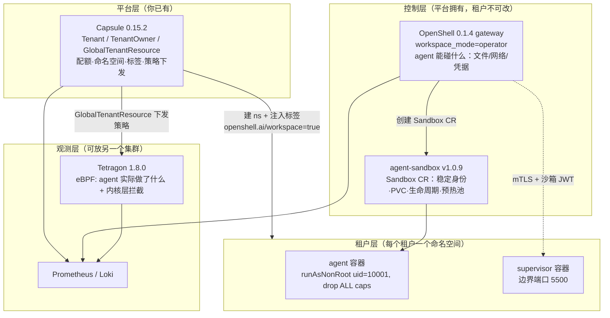

# 多租户 AI Sandbox：架构设计、使用样例与策略基线

配套可运行清单在同级 `poc/` 目录。本文所有结论都来自 2026-11-03 在
kind × 2（K8s v1.37.0, Docker Desktop 29.2.1 / kernel 6.12.72）上的实测，
未验证的部分单独列在 §6。

---

## 1. 架构

### 1.1 分层与职责



关键点：**OpenShell 的 Kubernetes compute driver 本身就构建在 agent-sandbox 之上**
（官方文档要求先装 agent-sandbox CRD），所以这三者不是拼装，是官方路径。

### 1.2 唯一需要你自己造的粘合：`workspace_mode = "operator"`

OpenShell 的 workspace→namespace 映射有三种，只有 `operator` 适合你（你已有 Capsule 租户体系）：

| 模式 | namespace 归谁 | 适用 |
|---|---|---|
| `shared` | 全部落一个 ns | 单团队，隔离最弱 |
| `managed` | OpenShell 自建 ns | 没有既有租户体系时 |
| **`operator`** | **平台预建，按 label selector 发现** | **✅ 与 Capsule 对齐** |

接线方式（实测通过）：
```yaml
# Capsule Tenant：给租户下所有 ns 注入标签
spec:
  namespaceOptions:
    additionalMetadata:
      labels: {openshell.ai/workspace: "true"}
```
```yaml
# OpenShell gateway values：按该标签发现 ns
server:
  drivers:
    kubernetes:
      workspaceMode: operator
      operatorNamespaceLabel: "openshell.ai/workspace=true"
```
网关日志确认接管：`operator namespace allowlist replaced from full relist total=2`

### 1.3 一个沙箱实际长什么样（实测）

```
namespace acme  (labels: capsule.clastix.io/tenant=acme, openshell.ai/workspace=true)
├─ Sandbox CR   agents.x-k8s.io/v1beta1   ← OpenShell 创建，agent-sandbox 落地
├─ pod poc-acme-1          labels: projectcapsule.dev/tenant=acme,
│                                   openshell.ai/boundary-role=workload
│    └─ container agent  (uid 10001, drop ALL caps, 无 SA token)
├─ pod os-supervisor-…    openshell.ai/boundary-role=supervisor
└─ 三层 NetworkPolicy 叠加：capsule-acme-0 / openshell-sandbox-workloads / …-ssh
```
**同一 Pod 上同时带 Capsule 与 OpenShell 的租户标签**——这条贯穿三层的一致性，
让配额、策略、审计都能用同一个键（`projectcapsule.dev/tenant`）聚合。这是这套组合最值钱的性质。

---

## 2. 使用样例

### 2.1 给一个已有租户开通 sandbox 能力（5 步，无手工逐项配置）

见 `poc/usage/01-onboard-tenant.sh`。要点：
1. `Tenant`（含 `additionalMetadata.labels` 那根接线）
2. `TenantOwner` ← **不注册的话 owner 连 `create ns` 的权限都没有**
3. 由 owner 自己建 ns（Capsule webhook 注入标签/配额/LimitRange/默认 NP）
4. 在该 ns 装 `openshell-workspace` chart（operator 模式下这是网关在该 ns 内**唯一**的 Secret 权限来源）
5. 下发该租户的 Tetragon 策略

### 2.2 租户侧使用 agent

```bash
openshell workspace create --name acme
openshell --workspace acme sandbox create --name try1 --cpu 200m --memory 256Mi -- python3 -u agent.py
openshell --workspace acme logs try1 --since 10m
openshell --workspace acme policy get try1          # 当前生效策略 + hash + version
openshell --workspace acme policy update try1 --add-endpoint "api.github.com:443:read-only:rest:enforce" \
  --binary /usr/local/bin/python3 --wait            # 实测：热更新成功 v1→v2，无需重启
```

### 2.3 高吞吐/低延迟：按租户的预热池

`poc/agent-sandbox/warmpool-acme.yaml` + `claim-acme-2.yaml`。实测延迟（同一集群、镜像已在节点）：

| 路径 | 到 Ready |
|---|---|
| 认领预热池（SandboxClaim） | **0.25 s** |
| 冷启动（镜像已缓存） | 0.92 s |
| 冷启动（需拉 20 MB 镜像） | 15.98 s |

⚠️ 池会吃租户配额：实测池 replicas × LimitRange default 撑爆 `capsule-acme-0` 时，
agent-sandbox 控制器被配额拒绝（`pods ... forbidden: exceeded quota: capsule-acme-0`）。
行为正确（租户边界生效），但**池容量必须进租户容量规划**，且模板必须显式写 `resources`。

### 2.4 跨集群：观测放平台集群

`poc/observability/scrape-tenants.yaml`。plane-b 的 Prometheus 直接抓 plane-a 的
Capsule(:30901) / Tetragon(:30902) / OpenShell(:32133)，三处 target 全部 `up`。
租户配额饱和度可直接算出来（这条是平台容量治理最有用的一条查询）：
```promql
max by (tenant,resource) (capsule_tenant_resource_usage / clamp_min(capsule_tenant_resource_limit,1))
# acme  limits.cpu 50% | globex namespaces 100% | globex count/pods 40% ...
```
Capsule 提供的租户级指标共 13 个，其中关键的两个是 `capsule_tenant_resource_usage` 与 `capsule_tenant_resource_limit`。

---

## 3. Tetragon：看到 agent 访问了谁、做了哪些危险操作

### 3.1 三条通道

| 通道 | 内容 | 用途 |
|---|---|---|
| `tetra getevents` | 实时事件（带 K8s 身份） | 排障、临时取证 |
| 节点 `/var/log/tetragon/tetragon.log`（JSONL，10MB×5 轮转） | 全量事件流 | 进 Loki/SIEM |
| `:2112/metrics` | 按 namespace/binary/workload 的计数 | 告警、趋势 |

事件自带租户身份，不需要你建映射：
```
process.pod.namespace = acme
process.pod.labels    = {"projectcapsule.dev/tenant":"acme"}   ← Capsule 注入
process.uid = 10001 · process.binary · process.arguments · process.parent
```

### 3.2 实测看到的"访问了谁"

```
agent:in-cluster       daddr=10.96.0.10:53  saddr=10.244.0.19:48100
agent:egress-external  daddr=1.1.1.1:53        ← 已被拦，仍被记录
agent:egress-external  daddr=142.1.1.1:80      ← 同上
agent:listen           saddr=0.0.0.0 sport=31339   ← agent 自己起服务 = 暴露面变化
```
**Tetragon 记录的是"尝试"**：NetworkPolicy / OpenShell 只决定成不成功，"agent 试过连哪儿"只有这层能看到。

### 3.3 实测看到的危险操作

| 行为 | message | 真实 args |
|---|---|---|
| 读配置/凭据目录 | `agent:open-sensitive` | `/etc/hosts`, `/etc/resolv.conf`, `/etc/localtime` |
| 删文件 | `agent:file-delete` | `/tmp/x1` |
| 移动/覆盖 | `agent:rename` | `/tmp/a` → `/tmp/b` |
| 起 shell | `agent:risky-exec` | caller=`python3` → exec target=`/bin/sh` |
| 装包 | `agent:package-manager` | `/usr/local/bin/pip` |
| 改运行身份 | `agent:setuid-attempt` | uid 0（噪声较高） |

### 3.4 两条通道的语义差别（必须同时用）

- **Tetragon**：agent 实际做了什么（内核真相）
- **OpenShell**：平台允许什么，以及**为什么允许/拒绝**
  ```
  OCSF NET:OPEN [MED] DENIED /usr/bin/curl(64) -> api.github.com:443 [policy:- engine:opa]
  OCSF CONFIG:LOADED Policy revision loaded [version:2] [hash:21baa807…]
  ```
  网关指标：`openshell_server_grpc_requests_total`、审计丢事件用 `openshell_ocsf_otlp_dropped_total`。
  两者放一起才有结论：一个说明"连了 1.1.1.1"，另一个说明"这条是谁放行的"。

---

## 4. 策略基线（`poc/tetragon/policies/`，全部实测加载成功）

| 文件 | 内容 | 已验证触发 |
|---|---|---|
| `00-egress-who.yaml` | 出网 / 集群内 / 监听端口 | ✅ egress, in-cluster, listen |
| `10-dangerous-fs.yaml` | 读敏感路径 / 删 / 移动 | ✅ 三者 |
| `20-supply-chain.yaml` | 装包（LSM）/ 改身份 | ✅ pip 命中；setuid |
| `30-exec-and-proc.yaml` | 全量执行审计 / 高风险执行 / 加载模块 | ✅ exec, risky-exec；load-module 见 §5.6 |
| `40-enforce-network.yaml` | **网络强制**：拒绝指定地址 / 元数据服务 | ✅ `PermissionError after 0.11s` |
| `50-enforce-exec.yaml` | **执行强制**：拒绝指定解释器 | ✅ `pip: Operation not permitted` |

策略的租户锚点（不是 Pod 名、不是容器 ID）：
```yaml
podSelector:
  matchLabels: {projectcapsule.dev/tenant: acme}
```
按租户差异化：每租户一份（`01-onboard-tenant.sh` 第 5 步做替换），
或由 Capsule `GlobalTenantResource` 自动下发（实测 `gtr … READY=True`，策略自动出现在租户 ns）。

---

## 5. 写策略时必须知道的 6 条（都是实测踩出来的）

1. **一个 TracingPolicy 只能有一个 section**。`kprobes` + `lsmhooks` 混写会整条不加载：
   `tracing policies with multiple sections ... are not supported`（报错不指向具体行，很容易误判成别的错）。
2. **kprobe 与 LSM 看到的"路径"不是同一个东西**：
   `sys_execve` 的 `args[0]` = 调用者**请求**的路径（`/bin/sh`）；
   `bprm_check_security` 的 `matchArgs args[0]` = **解析后**的真实文件（`/bin/busybox`）。
3. **`matchBinaries` 在 `bprm_check_security` 上匹配的是调用者**（那时二进制还没换）。要匹配将被执行的目标必须用 `matchArgs`。官方样例 `examples/tracingpolicy/lsm_bprm_check.yaml` 就是这个写法。
4. **BusyBox/Alpine 形态下按 `/bin/sleep`、`/bin/sh`、`/bin/mount` 写 exec 强制永不命中**（实测它们全部 → `/bin/busybox`；`os.system` 照样通过）。
   解法：agent 运行时用 Debian/Ubuntu 基座并按 digest 固定，或按 busybox 形态写策略。
5. **socket 参数的操作符不能混用**：`type: sockaddr` 只支持 `SAddr/SPort/Family`；
   对它用 `DAddr` **不报错但永不匹配**（我在这条上连着误判两次）。
   按目的地址筛连接要用 `type: sock` + `tcp_connect`。
   同理 `inet_listen` + `sock` 输出乱值（`family:"27840"`, `saddr:"invalid IP"`）；
   正确写法是 `security_socket_listen` + `type: socket`（实测拿到 `0.0.0.0:31339`）。
6. **能力型越权不该靠策略**：`mount()` / `init_module()` 实测在 syscall 到达内核前就被
   seccomp + drop ALL caps 挡住（errno 1 EPERM），因此 **Tetragon 看不见这类尝试**——
   这是分层正确，不是漏采。策略只该补"挡不住但可疑"的行为。

另外两条非 Tetragon 的：
7. `sys_rename` 不触发（glibc `rename()` 走 `sys_renameat(dirfd,old,newdirfd,new)`，下标 1/3）。
8. 版本获取陷阱：`docs.nvidia.com/openshell/latest` 讲 v0.1.6，而 GHCR tag 首页最高是 `0.0.42`——registry 分页所致，真实最新稳定是 `0.1.4`。**取 tag 必须分页拉全再排序。**

## 6. 强制层级的一个实际收益

同一个被禁的目的地，两种拦法对 agent 的行为差别很大（实测）：

| 拦法 | agent 侧表现 | 时间 |
|---|---|---|
| NetworkPolicy | 连接超时（会撑爆 agent 的超时/重试逻辑） | ~6 s |
| Tetragon `security_socket_connect` + `Override` | `PermissionError`（agent 能立刻改道/报错） | **0.11 s** |

对 agent 平台这是实打实的体验差异：快速失败比挂起好处理得多。
且它比 NetworkPolicy 更细——可按"哪个 binary 连哪个地址"决定（实测按 python 生效）。

---

## 7. 还没验证 / 上线前要处理

| 项 | 状态 |
|---|---|
| 沙箱 DNS 走 supervisor 边界 | ❌ 未达成。沙箱 `resolv.conf` 指向 `127.0.0.53`，到 cluster DNS:53 通、到 supervisor:53/:8080 超时。L7 策略热更新成功但拿不到官方教程里 `403 from proxy after CONNECT` 的行为，因为请求没到边界。→ 先在自己的环境验这段 |
| Capsule `runtimeClasses` 白名单 | ❌ 未拦住。设 `allowed:[gvisor]` 后用 tenant owner 建 `runtimeClassName: kata-containers` 被**接受**，到 kubelet 才失败。要按租户限制 gVisor/Kata，需自补一层 CEL ValidatingPolicy |
| 两条 sandbox 路径未打通 | ❌ 预热池认领出的沙箱**不带** OpenShell supervisor/policy（无网络边界、无凭据注入）。要"低延迟 + 有策略"需 OpenShell 支持从池认领，目前 `allow_driver_config` 不提供该语义 |
| hypervisor 级隔离 | ❌ kind/Docker Desktop 无现成 gVisor 节点镜像。当前强度来自 supervisor+NP+非 root+seccomp。跑不可信 LLM 代码仍需 gVisor/Kata |
| OpenShell 多集群 | ❌ K8s driver 用 in-cluster client，无 kubeconfig 选项 → 多集群只能每集群一套 gateway |
| HA | ⚠️ 默认 StatefulSet + 单副本 + SQLite 仅够 POC。生产要 `workload.kind=deployment` + 外部 PostgreSQL（且 PG 自身另做 HA） |
| Capsule 字段生命周期 | ⚠️ `resourceQuotas`/`limitRanges`/`networkPolicies`/`additionalMetadata` 已标 deprecated（apply 时会给迁移警告），方向是 `rules` + `TenantReplication`/`GlobalTenantResource`。新设计优先用后者 |
| `GlobalTenantResource` 与 Helm 的所有权冲突 | ⚠️ 对已由 Helm 管理的同名资源（如 `openshell-sandbox` SA）会 `applying of 1 resources failed`。二选一：SA 交给 GTR，或交给 per-ns Helm release |

---

## 8. 文件

```
poc/
├── kind/            两个 kind 集群配置
├── capsule/         tenants / tenant-owners / global-tenant-resource
├── openshell/       values-plane-a.yaml（operator 模式接线）
├── agent-sandbox/   warmpool + claim
├── tetragon/        policies/{00..50}-*.yaml  ← 策略基线(已验证)
│                  experiments/  早期探测(保留作证据)
├── observability/   scrape-tenants.yaml（跨集群抓取）
├── usage/           01-onboard-tenant.sh · 02-agent-visibility.md
├── scripts/         bootstrap.sh（一键重建） · bench-latency.py（延迟基准）
└── docs/            SUMMARY.md（本文） · FINDINGS.md（第一轮逐项验证与坑）
```
